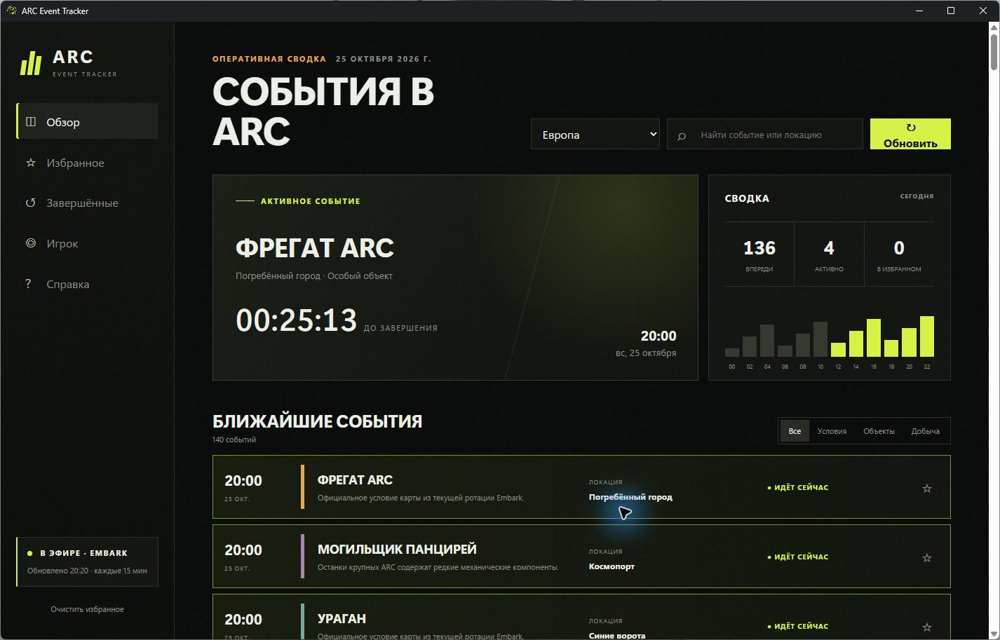
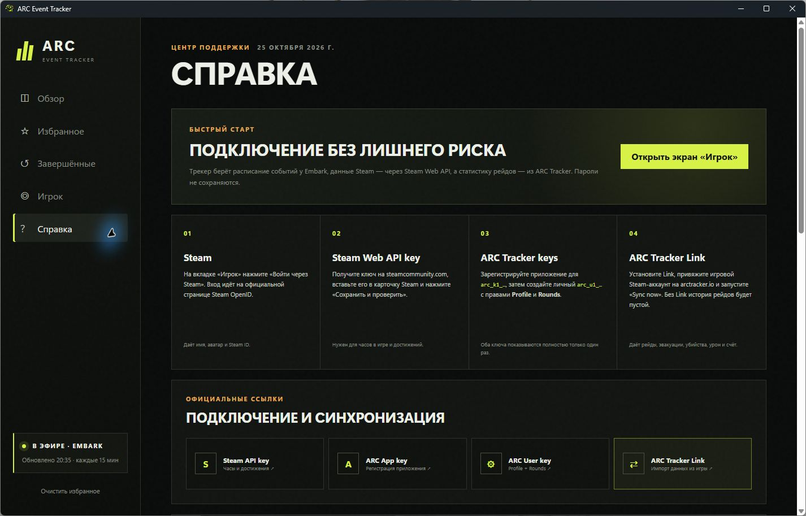

<div align="center">


# ARC Event Tracker

### События ARC Raiders — прямо на рабочем столе

Неофициальный Windows-трекер с живым расписанием Embark, уведомлениями,
Steam-профилем и статистикой рейдов ARC Tracker.

[](https://github.com/maleoipTu/arc-raiders-event-tracker/releases/latest)
[](https://github.com/maleoipTu/arc-raiders-event-tracker/releases/latest)
[](https://www.electronjs.org/)

### [⬇ Скачать ARC Event Tracker 0.4.0](https://github.com/maleoipTu/arc-raiders-event-tracker/releases/download/v0.4.0/ARC-Event-Tracker-Setup-0.4.0.exe)

</div>

---

## Что умеет

| | Возможность | Что это даёт |
|:--:|---|---|
| **◉** | **События в реальном времени** | Актуальная ротация карт и модификаторов из официального расписания Embark. |
| **★** | **Избранное и история** | Быстрый доступ к нужным событиям и уже завершённым ротациям. |
| **◔** | **Уведомления Windows** | Напоминания перед началом события с настраиваемым временем предупреждения. |
| **◎** | **Статистика игрока** | Steam-часы, достижения, эвакуации, убийства, урон и любимые карты. |
| **↗** | **Трей и автозапуск** | Трекер работает в фоне и может стартовать вместе с Windows. |
| **◆** | **Диагностика** | Быстрая проверка Embark, Steam, ARC Tracker, шифрования и уведомлений. |

## Интерфейс

<table>
  <tr>
    <td width="50%"></td>
    <td width="50%"></td>
  </tr>
  <tr>
    <td align="center"><b>Живое расписание</b><br><sub>Активное событие, таймер и ближайшие ротации</sub></td>
    <td align="center"><b>Встроенная справка</b><br><sub>Подключение Steam и ARC Tracker без догадок</sub></td>
  </tr>
</table>

## Установка

1. Перейдите в [последний релиз](https://github.com/maleoipTu/arc-raiders-event-tracker/releases/latest).
2. Скачайте файл `ARC-Event-Tracker-Setup-0.4.0.exe`.
3. Запустите установщик и выберите установку для текущего пользователя.

> [!NOTE]
> Windows может показать предупреждение SmartScreen: установщик пока не подписан коммерческим сертификатом. Контрольную сумму файла можно сверить на странице релиза.

## Подключение статистики

После установки откройте вкладку **Справка** — там есть пошаговая инструкция и ссылки на официальные страницы сервисов.

```text
Steam OpenID  →  имя, аватар и Steam ID
Steam Web API →  часы в игре и достижения
ARC Tracker   →  рейды, эвакуации, убийства, урон и карты
```

- Пароль Steam никогда не передаётся приложению.
- Для истории рейдов нужны ARC Tracker App key, User key и запущенный ARC Tracker Link.
- Все API-ключи шифруются Windows DPAPI и остаются на компьютере пользователя.

## Разработка

Требуются Node.js и pnpm.

```powershell
pnpm install
pnpm start
```

Сборка Windows-установщика:

```powershell
pnpm installer
```

## Источники данных

- расписание событий — официальный сайт Embark;
- профиль и игровая активность — Steam Web API;
- история рейдов — ARC Tracker API.

## Дисклеймер

Это неофициальный проект сообщества, не связанный с Embark Studios, Valve или ARC Tracker. Названия и товарные знаки принадлежат их владельцам. Панорамная иллюстрация в шапке создана специально для этого проекта и не является официальным артом игры.

---

<div align="center">
  <br>
  <sub>Следите за зоной. Не пропускайте нужные события.</sub>
</div>
