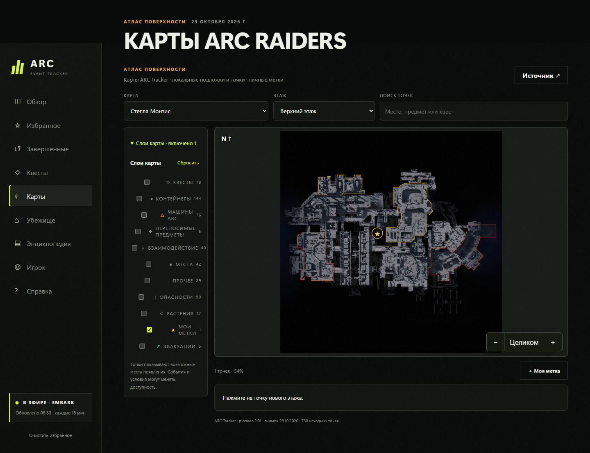
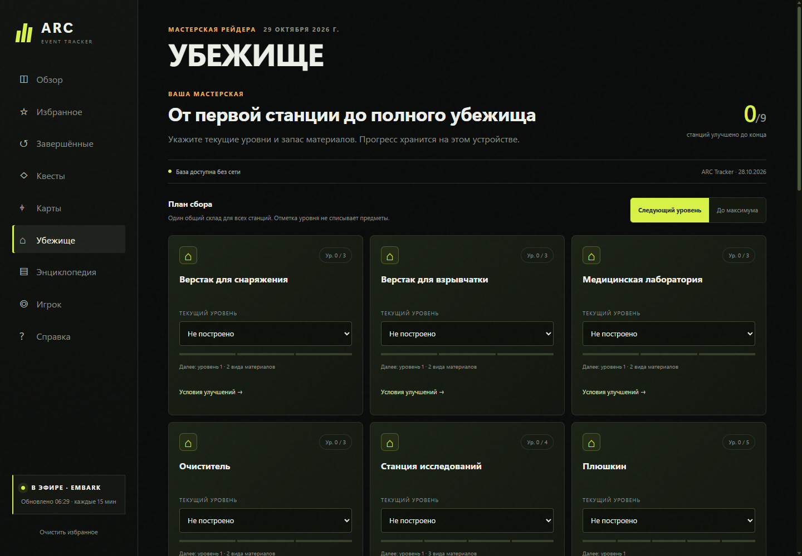
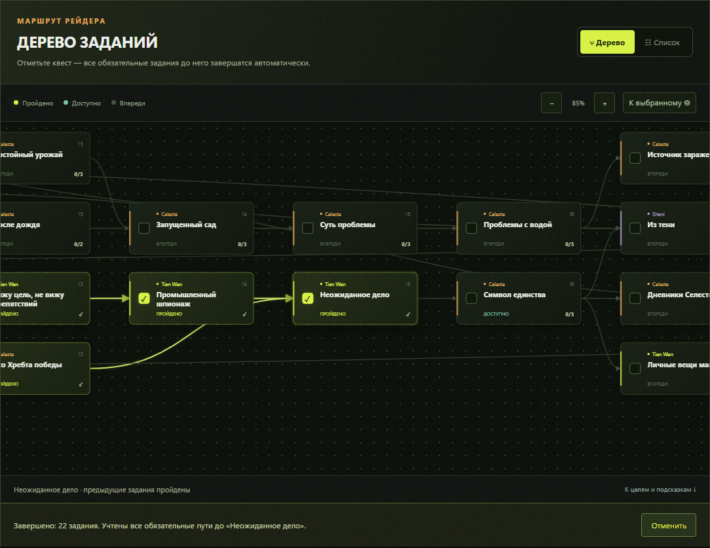

<div align="center">

# ARC EVENT TRACKER

**События ARC Raiders. Без лишних вкладок.**

Неофициальное приложение для Windows и Android: события ARC Raiders, интерактивные карты, квесты, энциклопедия и улучшения убежища. В Windows-версии также доступны Steam-профиль и статистика рейдов.

[](https://github.com/maleoipTu/arc-raiders-event-tracker/releases/latest)
[](https://github.com/maleoipTu/arc-raiders-event-tracker/releases/latest)
[](#android)
[](https://www.electronjs.org/)

### Скачать 0.6.0: [Windows EXE](https://github.com/maleoipTu/arc-raiders-event-tracker/releases/download/v0.6.0/ARC-Event-Tracker-Setup-0.6.0.exe) · [Android APK](https://github.com/maleoipTu/arc-raiders-event-tracker/releases/download/v0.6.0/ARC-Event-Tracker-Android-0.6.0.apk)

[Все релизы и контрольные суммы](https://github.com/maleoipTu/arc-raiders-event-tracker/releases/latest)

</div>

---

## Android

**Есть версия для Android — v0.6.0, Android 7.0 и новее.** Это отдельное устанавливаемое приложение с интерфейсом для телефона и планшета. [Скачать APK](https://github.com/maleoipTu/arc-raiders-event-tracker/releases/download/v0.6.0/ARC-Event-Tracker-Android-0.6.0.apk) · [Сборка и установка](mobile/README.md).

- Живое расписание Embark, выбор региона и таймеры событий.
- Поиск, избранное и завершённые события.
- Дерево из 123 квестов с русскими целями, подсказками и сохранением прогресса на устройстве.
- Семь интерактивных карт с этажами и личными метками, энциклопедия и планировщик убежища.
- Системные уведомления и встроенная справка.
- Просмотр сохранённого расписания и квестов без сети.

В Android-версии нет статистики игрока, входа Steam и настройки API-ключей. Расписание обновляется при запуске и каждые 15 минут, пока приложение открыто. Для продления напоминаний на следующий день открывайте трекер ежедневно.

Подписанный APK v0.5.0 проверен на Samsung SM-S931B с Android 17: загрузка событий, уведомления и сохранение прогресса квестов после перезапуска работают.

## Новое в 0.6.0 — карты, убежище и энциклопедия

Версия **0.6.0** добавляет [интерактивный атлас, убежище и энциклопедию](docs/ATLAS_AND_WIKI.md):
7 карт и 10 слоёв, 11 007 исходных точек ARC Tracker, личные метки,
992 предмета с рецептами, 24 типа ARC, 48 навыков и 10 станций мастерской.
Карты и текстовая база доступны без сети; иллюстрации карточек загружаются отдельно.
Полосы прокрутки оформлены в тёмной гамме приложения, без белой полосы.



Укажите уровни станций и запас материалов — трекер рассчитает, сколько осталось
собрать до следующего улучшения или до максимума. Общий склад учитывается один раз.



## Дерево квестов



Квесты показаны карточками со связями и развилками. Схему можно перемещать и масштабировать, а при желании — переключиться на привычный список.

Отметка квеста завершает **его и всех обязательных предшественников**, включая пути, которые сходятся в выбранном задании. Соседние ответвления и последующие задания не затрагиваются. Последнюю отметку можно отменить кнопкой **«Отменить»**; снятие отметки с отдельного квеста сохраняет прогресс предшественников.

## События под контролем

ARC Event Tracker помогает планировать вылазки: показывает текущую ротацию событий ARC Raiders, отсчитывает время до следующей и напоминает о важных моментах. Приложение можно свернуть в трей, чтобы расписание оставалось под рукой и не занимало экран.

### Возможности

| Функция | Что внутри |
| --- | --- |
| **Живое расписание** | Текущие и предстоящие события, карты, модификаторы и таймер до смены ротации. |
| **Избранное и история** | Быстрый доступ к интересующим событиям и сведениям о прошедших ротациях. |
| **Уведомления Windows** | Напоминания перед началом события с настраиваемым интервалом. |
| **Профиль Steam** | Имя, аватар, Steam ID, часы в игре и достижения при подключении соответствующих сервисов. |
| **Статистика ARC Tracker** | Рейды, эвакуации, убийства, урон и любимые карты при настроенной интеграции. |
| **Дерево квестов и подсказки** | 123 задания со связями, автоматическое завершение обязательных предшественников, отмена отметки и локальный прогресс. |
| **Интерактивные карты** | 7 карт, 10 слоёв, фильтры, поиск, масштабирование и личные метки. |
| **Энциклопедия** | 992 предмета, рецепты, переработка, 24 ARC, 48 навыков, события, проекты и торговля. |
| **Улучшения убежища** | Уровни станций, общий склад и расчёт недостающих материалов. |
| **Обновления и автозапуск** | Фоновая работа, запуск вместе с Windows и обновления через GitHub Releases. |
| **Диагностика** | Проверка подключений к Embark, Steam и ARC Tracker, а также работы шифрования и уведомлений. |

## Установка

1. Перейдите в [последний релиз](https://github.com/maleoipTu/arc-raiders-event-tracker/releases/latest).
2. Скачайте файл `ARC-Event-Tracker-Setup-x.y.z.exe`.
3. Запустите установщик и выберите установку для текущего пользователя.

> [!NOTE]
> Windows может показать предупреждение SmartScreen: установщик пока не подписан коммерческим сертификатом. Контрольную сумму файла можно сверить на странице релиза.

## Как это работает

```text
             РАСПИСАНИЕ EMBARK
                     |
                     v
          +---------------------+
          |  ARC EVENT TRACKER  |
          |                     |
          |  События  ·  Таймер |
          |  Избранное · Трей   |
          |  Уведомления        |
          +---------------------+
                 ^         ^
                 |         |
          STEAM API    ARC TRACKER
           Профиль     Статистика
```

Основное расписание доступно без подключения профиля. Интеграции Steam и ARC Tracker нужны только для дополнительных данных игрока.

## Начало работы

После запуска приложения:

1. Откройте главный экран и проверьте активное событие и ближайшие ротации.
2. Добавьте интересующие события в избранное.
3. Настройте уведомления и время предупреждения.
4. При необходимости подключите Steam и ARC Tracker через вкладку **Справка**.
5. Включите сворачивание в трей или автозапуск, если хотите держать трекер в фоне.

### Подключение сервисов

| Сервис | Данные | Что потребуется |
| --- | --- | --- |
| **Steam OpenID** | Имя, аватар, Steam ID | Авторизация через Steam. |
| **Steam Web API** | Часы в игре, достижения | Настройка доступа к Steam API. |
| **ARC Tracker** | Рейды, эвакуации, убийства, урон, карты | App key, User key и запущенный ARC Tracker Link. |

Инструкции по подключению находятся во встроенной вкладке **Справка**.

**Конфиденциальность:** приложение не запрашивает пароль Steam. API-ключи сохраняются локально с использованием Windows DPAPI. Передача данных внешним сервисам зависит от включённых интеграций.

## Разработка и запуск из исходников

Проект использует **Node.js**, **pnpm** и **Electron 39**.

```powershell
pnpm install
pnpm start
```

Сборка Windows-установщика из исходного кода:

```powershell
pnpm installer
```

Релиз и файлы автообновления публикуются GitHub Actions при отправке тега `v*`:

```powershell
git tag v0.6.0
git push origin v0.6.0
```

## Источники данных

- **Embark** — расписание игровых событий;
- **Steam Web API** — данные профиля и игровой активности;
- **ARC Tracker API** — статистика рейдов;
- **[ARC Tracker / RaidTheory ARC Data Project](https://github.com/RaidTheory/arcraiders-data)** — каталог квестов, лицензия MIT.

Обновить встроенную базу квестов после игрового патча:

```powershell
node scripts/sync-quests.mjs
```

Уведомления о лицензиях сторонних компонентов находятся в [`THIRD_PARTY_NOTICES.md`](THIRD_PARTY_NOTICES.md).

Доступность отдельных показателей зависит от работы внешних сервисов и корректной настройки интеграций.

## Частые вопросы

**Нужен ли Steam для просмотра событий?**

Нет. Подключение Steam требуется для информации о профиле и игровой активности.

**Можно ли пользоваться без ARC Tracker?**

Да. Статистика рейдов останется недоступной, но отслеживание событий продолжит работать.

**Будут ли напоминания, если окно закрыто?**

Для фоновой работы приложение должно оставаться запущенным, например в системном трее.

**Где искать инструкции по интеграциям?**

Во вкладке **Справка** внутри приложения.

## Статус проекта

ARC Event Tracker — независимый проект сообщества. Функции и интеграции могут изменяться по мере развития приложения.

## Правовая информация

Оригинальный код приложения распространяется под [лицензией MIT](LICENSE). Это не меняет права на сторонние данные, изображения и товарные знаки.

## Code signing policy

Идёт подготовка заявки на бесплатную подпись Windows-релизов через SignPath Foundation. Одобрение ещё не получено; текущие Windows-установщики остаются неподписанными.

[Политика подписи и ответственные](CODE_SIGNING_POLICY.md) · [Политика конфиденциальности](PRIVACY.md)

### Правообладатели

ARC Event Tracker не является официальным продуктом и не связан с **Embark Studios**, **Valve** или **ARC Tracker**. Названия, логотипы и товарные знаки принадлежат соответствующим правообладателям.

---

<div align="center">

**ARC EVENT TRACKER**

*Меньше проверки расписания. Больше времени на рейды.*

</div>
